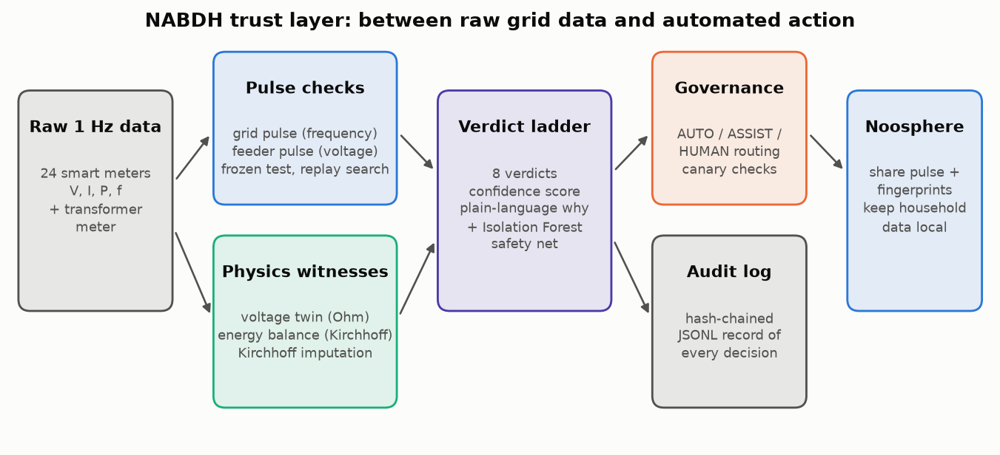
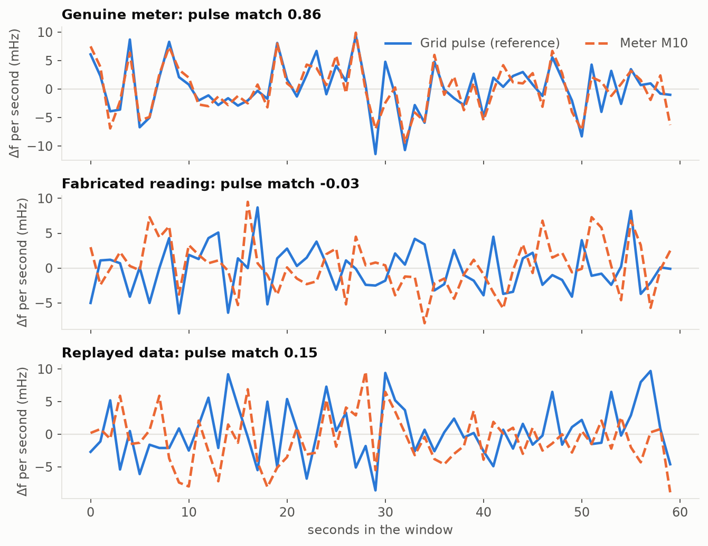
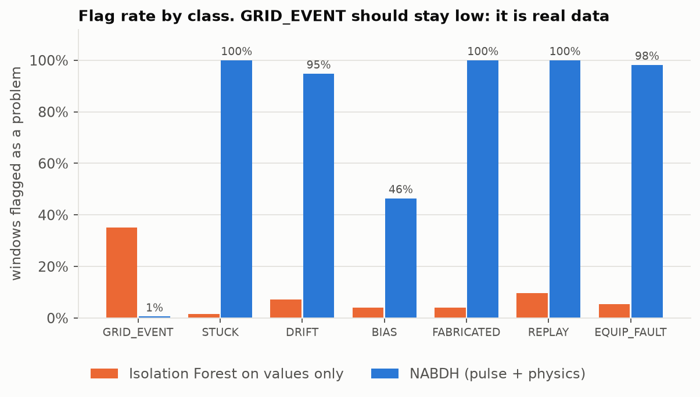

# NABDH (نبض): the grid signs its own data

NABDH ("pulse" in Arabic) is a trust layer for low-voltage grid data, built for the
**TSYP14 EnergyMind Tunisia** technical challenge (IEEE IES & PES).

It sits between raw smart-meter data and any automated decision. For every meter and every
minute it answers one question: *can this reading be trusted, and if not, is the grid
misbehaving or is the data?*



## The idea in one paragraph

Grid frequency is never exactly 50 Hz. It wobbles by a few millihertz every second as
generation and load chase each other, and every device on the synchronous grid sees the
**same** wobble at the **same** time. Tunisia shares that synchronous grid with Algeria,
Morocco and continental Europe. Voltage has a smaller local wobble shared by every meter on
the same transformer. NABDH calls these two signals the grid pulse and the feeder pulse.
A real meter records both pulses just by measuring. Fabricated or replayed data cannot carry
them, however plausible the values look. On top of the pulse, two physics checks (Ohm's law
along the feeder and Kirchhoff's energy balance at the transformer) tell a drifting sensor, a
tampered meter and a burnt customer connection apart.



## Phase 1 results

Four simulated one-hour test episodes (summer evening, heatwave, Ramadan iftar, winter
morning), 24 meters at 1 Hz, 40 injected data-quality anomalies, 4 real equipment faults and
8 genuine grid events. 11,340 scored meter-windows.

| | NABDH | Isolation Forest on values only |
|---|---|---|
| Precision | **0.967** | 0.084 |
| Recall | **0.904** | 0.052 |
| False-positive rate | **0.18 %** | 3.2 % |
| Real grid events mistaken for bad data | **0.6 %** | 35 % |

Every injected stuck, drifting, fabricated and replayed stream and every equipment fault was
flagged. The median time from the start of an anomaly to its first alarm was between 17 s
(replay) and 67 s (slow drift). Processing all 24 meters for one window takes about 6 ms on a
laptop.



Weak spots, measured: under-reporting meters (BIAS) are caught in 46 % of windows, because a
meter that draws little power or exports PV hides its bias inside the noise. Equipment faults
are always flagged but 41 % of the windows get the label DRIFT instead of EQUIPMENT_FAULT.
Both are Phase 2 work. Full numbers are in [`results/metrics.json`](results/metrics.json).

## What is in the repository

```
nabdh/            the trust layer
  simulator.py    1 Hz feeder: frequency, MV voltage, households, PV, radial voltage drop
  injectors.py    stuck, drift, bias, fabricated and replayed data
  pulse.py        grid pulse, feeder pulse, frozen test, replay-lag search
  physics.py      voltage twin, energy balance, bias onset matching, Kirchhoff imputation
  detector.py     calibration on clean data, rule ladder, Isolation Forest safety net
  explain.py      plain-language explanation for every verdict
  governance.py   AUTO / ASSIST / HUMAN routing, incidents, canary checks
  audit.py        hash-chained decision log
scripts/          generate_dataset.py, evaluate.py, make_figures.py
data/             the benchmark dataset and its data card
results/          metrics, confusion matrix, decision log, example explanations, figures
docs/             project proposal (Markdown + PDF), governance and noosphere designs
tests/            physics and guarantee checks (pytest)
```

## Run it

```bash
pip install -r requirements.txt
python scripts/generate_dataset.py   # rebuilds data/ (seeded, identical every time)
python scripts/evaluate.py           # calibrates, detects, scores, writes results/
python scripts/make_figures.py       # results/figures/*.png
python -m pytest -q
```

## The eight verdicts

| Verdict | What happened | Evidence | Who acts |
|---|---|---|---|
| NORMAL | nothing | both pulses present, physics agrees | nobody |
| GRID_EVENT | real frequency dip or voltage sag | pulse intact, whole feeder moves together | AI alerts operations |
| STUCK | frozen sensor | readings stop wobbling | AI quarantines, opens ticket |
| DRIFT | sensor calibration creeping | pulse intact, voltage off the physics model | AI corrects if confident |
| BIAS | meter under-reports | energy gap opens at the second its reading drops | human |
| FABRICATED | values invented | no pulse at all | human |
| REPLAY | old real data re-sent | pulse matches an earlier moment | human |
| EQUIPMENT_FAULT | loose or burnt connection | pulse intact, voltage sinks with the house's own current | human |

Examples of the explanations NABDH writes are in
[`results/example_explanations.md`](results/example_explanations.md).

## Documents

- [Project proposal (PDF)](docs/NABDH_Proposal.pdf) and its [Markdown source](docs/proposal.md)
- [Governance design](docs/governance.md): who decides, canaries, audit log
- [Noosphere design](docs/noosphere.md): what nodes share and what stays local
- [Data card](data/README.md): how every anomaly was generated

## License

MIT, see [LICENSE](LICENSE).
