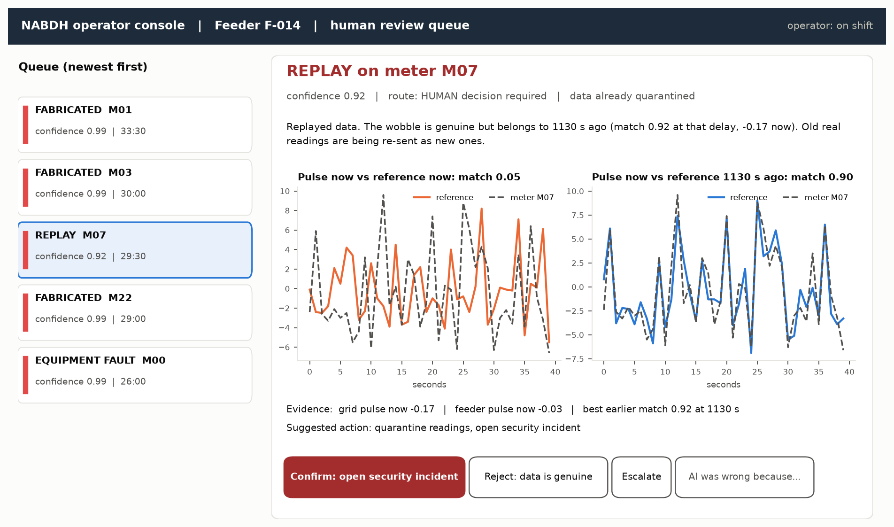

# Governance: who decides what

## Rule of thumb

The AI may always stop trusting data on its own, because quarantining a reading is
reversible and harms no one. Any action that touches a person (a bill, a fraud
suspicion, a disconnection) or an asset (a crew dispatch, a switching order) goes to a
human.

## Routes

| Route | Meaning | Operator effort |
|---|---|---|
| AUTO | NABDH acts and logs it. The operator sees it in the daily digest and can reverse it. | none |
| ASSIST | NABDH prepares the action. The operator confirms or rejects with one click. | seconds |
| HUMAN | The operator decides. NABDH only quarantines the data and presents the evidence. | minutes |

## Policy per verdict

| Verdict | Action | AUTO if confidence ≥ | ASSIST if confidence ≥ | Otherwise |
|---|---|---|---|---|
| GRID_EVENT | accept data, alert grid operations | 0.80 | 0.00 | |
| STUCK | quarantine readings, open maintenance ticket | 0.90 | 0.60 | HUMAN |
| DRIFT | apply offset correction, schedule recalibration | 0.95 | 0.70 | HUMAN |
| BIAS | quarantine billing data, request field inspection | never | never | HUMAN |
| FABRICATED | quarantine readings, open security incident | never | never | HUMAN |
| REPLAY | quarantine readings, open security incident | never | never | HUMAN |
| EQUIPMENT_FAULT | dispatch crew to customer connection | never | never | HUMAN |
| UNEXPLAINED | quarantine readings, human review | never | never | HUMAN |

The thresholds live in `nabdh/governance.py` and are versioned with the code, so any
change to who-decides-what shows up in the git history and in the audit log header.

On the Phase 1 test set this policy produced 94 incidents: 29 handled automatically
(8 grid events, 8 stuck sensors, 13 drift corrections), 1 drift correction sent for
one-click approval, and 64 sent to the human queue (see `results/governance_summary.json`).

## Incidents, not windows

The detector works on 60-second windows, but nobody wants twenty tickets for one stuck
sensor. Consecutive windows of the same meter and verdict merge into one incident, and a
grid event is one feeder-wide incident however many meters saw it.

## Operator interface (Phase 2 build, Phase 1 design)

The mockup above shows a real replay incident from the Phase 1 test run.

One screen per incident, read top to bottom:

1. Verdict, confidence, route, and the recommended action.
2. The plain-language explanation (from `nabdh/explain.py`).
3. The evidence plot: the meter's pulse over the reference pulse for that minute. A person
   can see in two seconds whether the two curves move together.
4. Buttons: approve, reject, escalate, and "AI was wrong because..." (free text, logged).

## Over-trust and under-trust

Over-trust (the operator approves whatever the AI says) is measured with canaries. A small
share of the human queue (5 % in the prototype) is planted known-answer cases, for example
a fabricated stream that the operator should reject. Airport X-ray screening uses the
same idea (threat image projection). Canaries are tagged in the log and never reach
billing or crews.

Under-trust (the operator ignores correct verdicts) is measured as the share of verdicts the
operator overrode that later turned out right, for example after a field inspection.

Both rates go on the supervisor dashboard. If over-trust rises, the interface stops showing
the AI's recommendation first and asks the operator to judge the plot before revealing it.
If under-trust rises, the team reviews the explanations for those cases.

## Accountability

Every decision, automatic or human, goes into `results/decision_log.jsonl`. Each record
holds the evidence numbers, the explanation, the route, the action and the SHA-256 hash of
the previous record. Editing or deleting a past record breaks the chain, and
`nabdh.audit.verify()` reports the first broken record. Responsibility follows the route:

- AUTO: the team that approved the policy thresholds.
- ASSIST and HUMAN: the operator who clicked, with the AI evidence they saw stored next to
  their decision.
