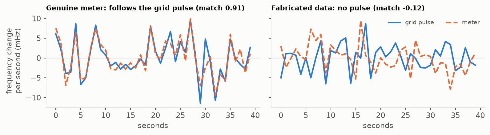
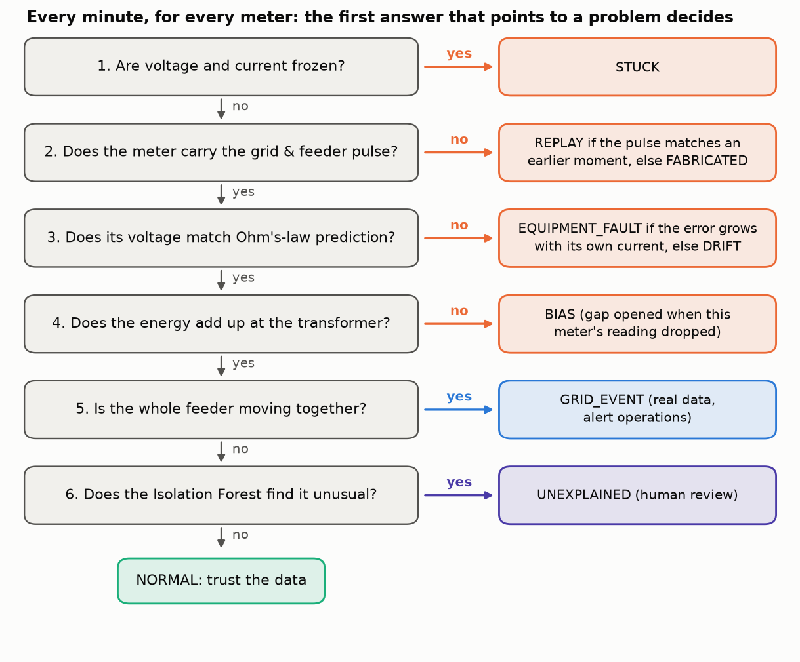
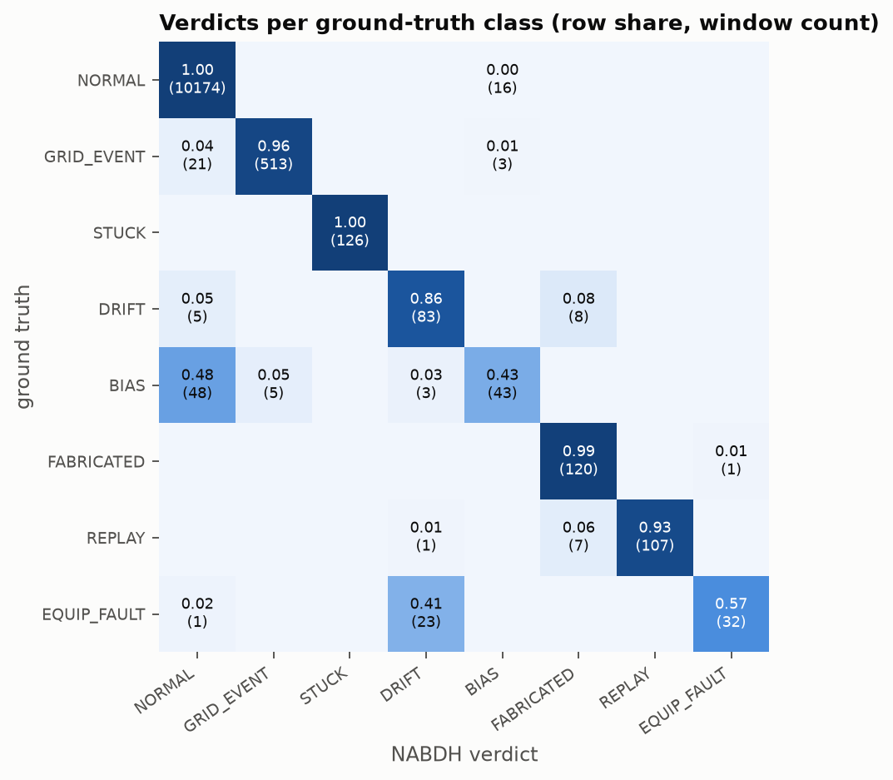
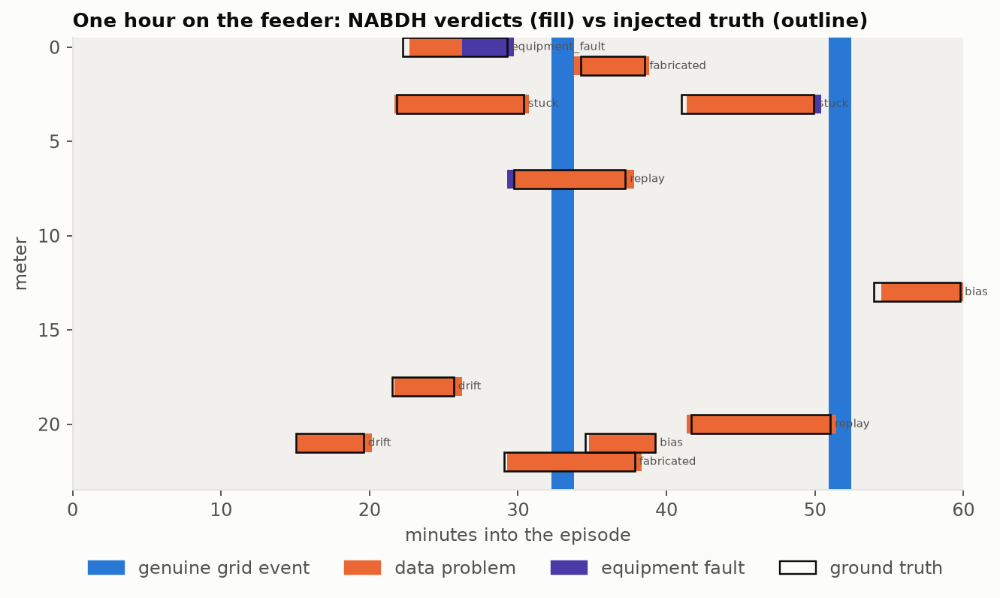

# NABDH: the grid signs its own data

## A pulse-based trust layer for Tunisian low-voltage grid data

> **The idea in one sentence.** Every genuine meter reading carries the grid's random
> frequency wobble, the same at every point of the grid at the same second, and fake or
> replayed data cannot reproduce it. NABDH checks for this "pulse", then uses Ohm's and
> Kirchhoff's laws to tell a broken sensor, a tampered meter and a real fault apart, before
> any automated system acts on the data.

| Phase 1 result (simulated feeder, 11,340 meter-minutes) | NABDH | Classic anomaly detector |
|---|---|---|
| Problems caught (recall) | **90 %** | 5 % |
| Alarms that were right (precision) | **97 %** | 8 % |
| False alarms on normal data | **0.18 %** | 3.2 % |
| Real grid events wrongly called bad data | **0.6 %** | 35 % |

TSYP14 Technical Challenge, EnergyMind Tunisia (IEEE IES & PES). Phase 1 project proposal.

**Team NABDH:** Mohamed Rayen Romdhani, Mouath Chouchane, Yassine Ben Abdallah, Zina Djerbi.
IEEE ENIM Student Branch. All four members are IEEE Power & Energy Society (PES) members.
Submitted 15 October 2026.

**Bonus criteria addressed:** PES membership (all members) and business scope: budget,
implementation, continuous training and deployment cost (section 8).

**Repository:** [github.com/RayenRomdhani/nabdh](https://github.com/RayenRomdhani/nabdh)

## 1. Summary

Automated grid decisions are only as good as the data behind them. A frozen sensor, a
drifting voltage transformer or a tampered meter can feed false numbers into billing, load
forecasting or protection logic without anyone noticing. NABDH ("pulse" in Arabic) is a trust
layer that checks every reading before it reaches those systems.

Its core observation comes from physics. The grid frequency wobbles by a few millihertz every
second, identically for every device on the synchronous grid, and the voltage on a feeder has
its own small wobble shared by every meter on that transformer. A real meter records both
pulses automatically. Invented or replayed data cannot, however realistic its values look.
NABDH combines this pulse check with two physics witnesses (Ohm's law along the feeder and
the energy balance at the transformer) and sorts every meter-minute into one of eight
verdicts, each with a confidence score, a plain-language explanation, and a route that says
whether the AI may act alone or a human must decide.

On a simulated Tunisian feeder with 24 meters at 1 Hz, the Phase 1 prototype reaches 0.97
precision and 0.90 recall at a 0.18 % false-positive rate, and mistakes only 0.6 % of genuine
grid events for bad data. A classic Isolation Forest on the same values reaches 0.08 precision
and 0.05 recall and raises false alarms on 35 % of genuine grid events.

## 2. Scope

We monitor one **smart-metered residential neighbourhood**: an MV/LV transformer and the
low-voltage feeder behind it, with 24 single-phase smart meters, eight of them with rooftop PV
of the PROSOL Elec type. The transformer has its own meter, which serves as the trusted
reference.

We chose this slice because it is where Tunisia's grid is growing fastest in number of data
points (smart meters, rooftop PV, home IoT), where a wrong reading touches a customer
directly (billing, disconnection), and where the operator has the least visibility today.

In scope: data trust for voltage, current, active power and frequency at 1 Hz; telling
genuine grid events from data problems; telling data problems from real equipment faults
at the customer connection; escalation and audit; a design for sharing between
neighbourhoods.

Out of scope for Phase 1: three-phase unbalance, harmonics and power-quality indices, MV
network faults, and forecasting. NABDH protects the data those systems use; it does not
replace them.

## 3. Objectives

| Goal | Measurable target | Phase 1 result |
|---|---|---|
| Detect problems | recall ≥ 0.85 on data-quality anomalies and equipment faults | 0.90 |
| Few false alarms | false-positive rate ≤ 1 % on normal windows | 0.18 % |
| Real events stay real | ≤ 5 % of genuine grid events flagged as data problems | 0.6 % |
| Fast enough | median alarm latency ≤ 90 s, processing ≤ 1 s per minute of data | 17 to 67 s, 6 ms |
| Explain everything | 100 % of verdicts with confidence and plain-language reason | 100 % |
| Humans own consequences | 100 % of accusatory or asset actions routed to a human | 100 % |
| Share safely | no raw consumption leaves a node | design (Phase 2 prototype) |

## 4. The core idea: the grid's pulse

Frequency on an AC grid follows the balance between generation and load. When load rises
slightly faster than generation, the rotating machines slow down and frequency drops by a few
millihertz. When generation leads, it rises. Millions of small load changes make this a random
signal, and because all synchronous machines are locked together, **every point of the
interconnection sees the same random signal at the same instant**. Tunisia is synchronously
linked with Algeria and Morocco and, through the Morocco-Spain interconnection, with the
Continental European grid. Audio forensics has used this "electric network frequency"
signature since the mid-2000s to prove when a recording was made. NABDH uses it to prove when
a meter reading was made.

Voltage adds a second, local signature. Every meter on the same transformer hangs off the same
secondary winding, so MV-side voltage changes and shared cable drops reach all of them
together. After removing what each meter's own load explains (Ohm's law along the feeder),
the remaining wobble is common to the whole feeder.

So a genuine reading carries two watermarks it cannot fake: the **grid pulse**, which proves
the moment, and the **feeder pulse**, which proves the place. We compare second-to-second
*changes*, never raw values. A meter drifting by 5 V still has the right pulse. A fabricated
stream sitting at a perfect 231 V does not.

### Words used in this proposal

| Term | Meaning |
|---|---|
| Grid pulse | the second-by-second wobble of grid frequency, identical everywhere on the grid |
| Feeder pulse | the voltage wobble shared by all meters on one transformer |
| Pulse match | correlation between a meter's changes and the reference changes (1 = identical, 0 = unrelated) |
| Voltage twin | each meter's voltage predicted by Ohm's law from the transformer voltage and all currents |
| Energy gap | transformer power minus all meter powers minus cable losses; near zero when everyone is honest |
| Window | one minute of data from one meter, checked every 30 s |
| Verdict | NABDH's conclusion for a window: one of 8 classes (section 6.1) |
| Incident | consecutive windows with the same verdict on the same meter, reviewed as one ticket |

## 5. Data and anomaly-simulation plan

Fault-labelled grid data at one second does not exist publicly for Tunisia, so Phase 1 uses
a seeded simulator (`nabdh/simulator.py`), as the challenge allows. It models grid frequency
and MV voltage as mean-reverting random processes, households as base load plus cycling air
conditioners or heaters, fridges and kettle/oven bursts, rooftop PV with a shared cloud
factor, and the radial voltage drop along the feeder. Six one-hour episodes cover a summer
evening, a heatwave, a Ramadan evening with the synchronised cooking surge before iftar, and a
winter morning. Two clean episodes are used only for calibration.

Genuine events are produced inside the physics: a 180 mHz frequency dip (generator trip
elsewhere on the grid), a 10 % MV voltage sag for 20 s, and a loose customer connection
(service resistance from 0.04 to 0.5 Ω with arcing). Data-quality problems are injected on the
reported values only:

| Injected | How |
|---|---|
| Stuck sensor | every channel repeats its value from the start of the fault |
| Drift (degraded sensor) | voltage offset ramps to +3 to +8 V |
| Bias (miscalibration or tampering) | current and power scaled by 0.4 to 0.7 |
| Fabricated reading | synthetic voltage, power and a realistic 50 Hz wobble, made without grid access |
| Replay | the meter's own genuine data from 10 to 30 minutes earlier |

The four test episodes hold 40 injections, 4 equipment faults and 8 grid events. Every one is
listed in `data/ground_truth.csv`, and `data/README.md` documents the generation in full.

**Why this is a fair test, even though it is simulated.** We tried not to make it easy:

- Thresholds and the Isolation Forest are learned from the two clean episodes only. The test
  episodes are never used for tuning, and the heatwave and Ramadan scenarios never appear in
  training.
- The forger is given every advantage we could think of: fabricated data has the right level,
  the right noise and even a realistic 50 Hz wobble, and replayed data is the meter's own
  genuine recording.
- Bias is injected at mild levels (readings at 40 % to 70 % of the true value) on random
  meters, including one with rooftop PV whose net power is close to zero. That is why it is
  our weakest class, and we report it.
- The baseline sees exactly the same data and the same clean calibration episodes.
- Everything is seeded: anyone can rebuild the dataset and get the same numbers with
  `python scripts/evaluate.py`.

Real feeders are noisier than our simulator, so the numbers will drop on real data; Phase 2
is where we measure by how much.

Phase 2 plan: replace the simulated frequency with a public 1 s Continental European
frequency recording, shape household profiles on published STEG load curves, add a
three-phase feeder, and add harder attacks (a forger who copies the public frequency, slow
bias that never jumps).

## 6. Preliminary design for each challenge goal

### 6.1 Anomaly and bias detection

Every 30 seconds, NABDH looks at the last minute of each meter and asks six yes/no questions
in a fixed order. The first answer that points to a problem decides the verdict.

What each question checks, in plain words:

1. **Frozen?** Real mains voltage always moves a little. A meter whose voltage and current
   do not change at all for most of the minute has a stuck sensor.
2. **Pulse?** We correlate the meter's second-by-second frequency changes with the
   transformer's, and its voltage changes with what physics predicts. A genuine meter scores
   about 0.9, fake data about 0. If the pulse is missing, NABDH searches the last 40 minutes
   of the reference: a match at an earlier moment means replayed data, and gives the delay.
3. **Voltage right?** From the transformer voltage and every meter's current, Ohm's law
   predicts each meter's voltage (the voltage twin). A drifting sensor reads off the
   prediction while its neighbours do not. If the error grows when the house draws more
   current, the problem is physical: a loose or burnt connection.
4. **Energy adds up?** Transformer power must equal the sum of all meters plus cable
   losses. If power suddenly goes missing in the same second one meter's reading drops by
   the same amount, that meter is under-reporting.
5. **Whole feeder moving?** A frequency dip or a voltage sag that every meter sees in step
   is a genuine grid event. The data is real and should be acted on.
6. **Anything else odd?** An Isolation Forest trained on normal data catches patterns that
   none of the rules describe.

Two details keep this robust. Once a meter is caught lying, its current is replaced by what
the transformer says is missing (Kirchhoff's current law), so it cannot spoil its neighbours'
Ohm's-law check. And because the checks compare *changes* across meters, a real grid event
moves every meter together and never looks like a sensor problem, which is exactly the
distinction the challenge asks for.

### 6.2 Confidence scores and explainability

The evidence is the explanation. Each verdict's confidence is a logistic function of how far
the deciding measurement sits beyond its threshold (for a replay, the match at the found
delay). Thresholds come from clean data, so they are numbers an engineer can check. Each
verdict comes with a sentence written for an operator, for example:

> Meter M07: replayed data. The wobble is genuine but belongs to 1130 s ago (match 0.90 at
> that delay, 0.07 now). Old real readings are being re-sent as new ones.

The operator interface shows the meter's pulse over the reference pulse for that minute, so a
person can check the claim by eye. Every decision goes to a hash-chained log with the
evidence, the explanation and the action. We use rule-backed scoring with physical
thresholds by design: SHAP or LIME would explain a black box, and we do not need one.

### 6.3 Human-AI escalation and governance

The AI may always stop trusting data on its own, because that is reversible. Anything that
acts on a customer or an asset needs a human.

| Verdict | Action | Route |
|---|---|---|
| GRID_EVENT | accept data, alert operations | AUTO at confidence ≥ 0.80 |
| STUCK | quarantine, maintenance ticket | AUTO ≥ 0.90, one-click ≥ 0.60 |
| DRIFT | offset correction, recalibration | AUTO ≥ 0.95, one-click ≥ 0.70 |
| BIAS | quarantine billing data, field inspection | always HUMAN |
| FABRICATED, REPLAY | quarantine, security incident | always HUMAN |
| EQUIPMENT_FAULT | crew to customer connection | always HUMAN |

Consecutive windows merge into incidents: the test set produced 94 incidents, of which 29
were handled automatically, 1 went to one-click approval and 64 to the human queue.

The operator reviews each incident on one screen: verdict and confidence, the plain-language
reason, the meter's pulse drawn over the reference so the claim can be checked by eye, and
four buttons. The mockup below is filled with a real replay incident from our test run. The
working console is a Phase 2 deliverable.

Over-trust is measured with canaries: 5 % of the human queue are planted known-answer cases,
the same idea as threat image projection in airport X-ray screening. Under-trust is measured
as the share of correct verdicts the operator overrode. If over-trust rises, the interface
hides the AI's recommendation until the operator has judged the plot. Details are in
`docs/governance.md`.

### 6.4 Shared learning across the noosphere

Each neighbourhood, factory or microgrid runs its own node. The privacy line is simple: we
share the heartbeat, not the household.

| Shared | Kept local |
|---|---|
| grid pulse (frequency, identical everywhere, so not personal) | raw per-meter V, I, P (at 1 Hz it reveals presence and appliances) |
| grid event attestations | meter IDs, addresses, billing |
| anomaly fingerprints of confirmed incidents, with noise and k ≥ 5 | local topology |
| calibration statistics | individual operator decisions |

Shared pulses let nodes check each other's reference meters. Event attestations confirm that a
dip is grid-wide. Matching fingerprints on several nodes reveal a coordinated campaign.
Median-aggregated thresholds let a new node start without weeks of clean data while resisting
a poisoned peer. Raw consumption stays local because it is personal data under Tunisia's
Organic Law 2004-63. The message formats and privacy guards are in `docs/noosphere.md`.
Phase 1 runs a single node; the sharing layer is designed and will be prototyped in Phase 2.

## 7. Phase 1 results

Test set: 4 episodes, 11,340 scored meter-windows, none of them used for tuning (see the
fairness notes in section 5).

| Metric | NABDH | Isolation Forest on values |
|---|---|---|
| Precision | 0.967 | 0.084 |
| Recall | 0.904 | 0.052 |
| F1 | 0.934 | 0.065 |
| False-positive rate | 0.18 % | 3.2 % |
| Genuine grid events flagged as bad data | 0.6 % | 35 % |

All 8 stuck, 8 drift, 8 fabricated and 8 replay injections and all 4 equipment faults were
detected. Median latency from anomaly start to first alarm: 17 s for replay, 35 s for
fabricated, 40 s for equipment faults, 50 s for stuck, 52 s for bias, 67 s for slow drift.
One window of all 24 meters takes about 6 ms to process.

Two weaknesses are clear in the confusion matrix. Bias is caught in 46 % of windows (5 of 8
injections): a meter that draws little power, or exports PV, hides its bias inside the noise
of the energy balance. Equipment faults are always flagged, but 41 % of their windows are
labelled DRIFT, because when the house's current barely changes, a loose connection and a
drifting sensor look alike. Both are first targets for Phase 2 (longer evidence windows and
the meter's voltage response to its own load steps).

## 8. Business scope

These are planning estimates for a utility pilot, to be refined in Phase 2.

Deployment path. NABDH is software only. It needs 1 s voltage, current and frequency, which
power-quality analysers, substation monitoring and advanced meter data concentrators already
produce. A pilot starts with the transformer meter and the meters that can stream at 1 s,
running on an edge PC at the substation or in a utility cloud.

| Item | Estimate |
|---|---|
| Pilot integration (2 engineers, 4 months, 50 feeders) | 60,000 to 90,000 TND one-off |
| Compute | under 1 TND per feeder per month (6 ms per minute of data) |
| Continuous training | automatic weekly recalibration on clean windows; 0.5 FTE data engineer per 1,000 feeders |
| Operator training and canary programme | 2 days per control-room team |
| Licence model | per monitored feeder per month, about 15 to 25 TND |

Value comes from three places: fewer wrong automated actions on bad data, earlier detection
of meter tampering (non-technical losses), and earlier crew dispatch to dangerous loose
connections. The pilot is meant to measure each of them on real feeders.

## 9. Plan for Phase 2

1. Operator web dashboard: incident queue, pulse plot, approve/override, canary dashboard.
2. Two- to five-node noosphere prototype with signed pulse and fingerprint exchange.
3. Real 1 s frequency data, STEG-shaped load profiles, three-phase feeder.
4. Better bias and fault separation; a forger who copies public frequency data.
5. Demo video and full report.

## 10. Risks and limits

- The method needs 1 s data. Many installed meters report every 15 minutes, so a first
  deployment covers feeders with power-quality or concentrator data.
- A forger with access to a real frequency stream could fake the grid pulse. The feeder pulse
  and the physics twin still catch this in our design, and it is a Phase 2 test case.
- Simulated data is cleaner than reality. Thresholds come from clean data and will need
  recalibration on real feeders.

## References

1. C. Grigoras, "Digital audio recording analysis: the Electric Network Frequency (ENF)
   criterion", International Journal of Speech, Language and the Law, 2005.
2. F. T. Liu, K. M. Ting, Z.-H. Zhou, "Isolation Forest", IEEE ICDM, 2008.
3. TSYP14 EnergyMind Tunisia challenge specification, IEEE IES & PES, 2026.
4. Tunisian Organic Law 2004-63 on the protection of personal data.
